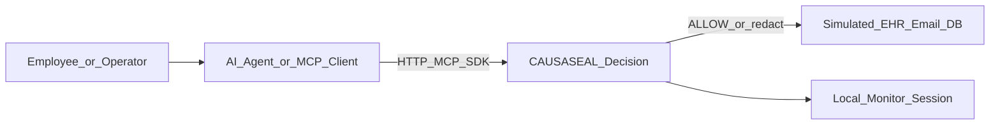
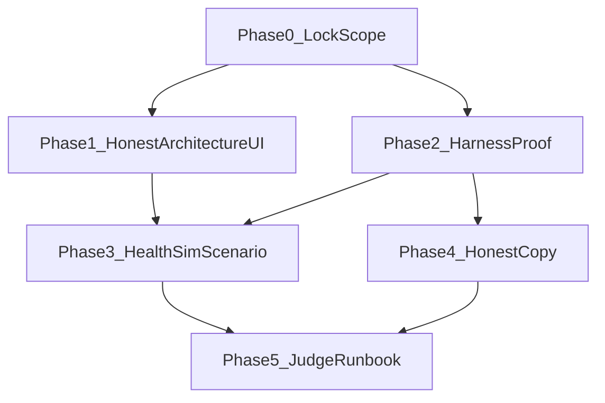

# أخذ معمارية الفريق صح (بدون تخريب الفكرة)

## القرار الثابت (لا تفاوض داخل التنفيذ)

- **نأخذ الرسم كقالب عرض وقصة لجنة**، مو كقائمة تكاملات نبنيها الآن.
- **ما يُبنى في هذه الخطة:** Entra / OAuth / OIDC، EHR/ERP حقيقي، Email Gateway حقيقي، Syslog/SIEM خارجي، إصدار متاجر، توسيع Capacitor.
- **ما يُكمَّل:** نواة القرار الموجودة + HTTP/MCP/SDK + إثبات يعاد أن الهارنس وحده ما يكفي + سيناريو صحي **محاكى ومعلّم صراحة**.
- **مقياس النجاح:** محكّم يعيد تشغيل صف واحد ويقول: «الهارنس سمح؛ CAUSASEAL منع الأصل لأن الثوابت نفسها.» بدون وعد أنظمة عالمية.

خريطة صادقة للرسم مقابل الكود:

| مربع الرسم | عندنا الآن | في هذه الخطة |
| --- | --- | --- |
| Control Plane | `engine/*` + اعتراض | نسمّيه ونرتّب العرض حوله |
| Effect Gateway | `runOpsAgent` + redact | نبقيه محليًا ونوضّح أنه بوابة قرار قبل الإرسال |
| MCP/API | `/mcp` + `/api/gateway/intercept` | نثبّته كقناة النداء |
| IAM / Entra | غير موجود | شريحة «لاحقًا» فقط — لا كود |
| EHR / Email | محاكاة تسليم | سيناريو صحي محاكى بملصق «محاكاة» |
| SIEM | مراقبة محلية | نربطها بصريًا كـ SOC العرض فقط |

الملفات المحورية: [`docs/مطابقة-الفكرة-مع-الكود.md`](docs/مطابقة-الفكرة-مع-الكود.md)، [`app/(dashboard)/impact`](app/(dashboard)/impact)، [`engine/ops-agent.mjs`](engine/ops-agent.mjs)، [`engine/fixtures/novel-leak.mjs`](engine/fixtures/novel-leak.mjs)، [`lib/connectors.ts`](lib/connectors.ts)، [`components/causaseal/connectors-*.tsx`](components/causaseal).

---

## المرحلة 0 — قفل الحدود مع الفريق (4 مهام)

1. كتابة فقرة قفل في أعلى قسم جديد داخل [`docs/مطابقة-الفكرة-مع-الكود.md`](docs/مطابقة-الفكرة-مع-الكود.md): الرسم = هدف عرض؛ التنفيذ الحالي ≈ قرار + موصّلات؛ Entra/EHR/SIEM خارج الدفعة.
2. لصق جدول الخريطة أعلاه في نفس الملف تحت عنوان «معمارية الفريق مقابل المستودع».
3. صياغة رد قصير للفريق (5–7 أسطر) يوافق على الرسم كشريحة ويحدد الممنوع الآن.
4. تحديث «مسار د» في ملف المطابقة ليضم صراحة: لا Entra، لا OAuth، لا EHR حقيقي، لا Syslog في هذه الدفعة.

**خروج المرحلة:** الفريق ما يطلب Integrations مؤسسية كـSprint قادم.

---

## المرحلة 1 — شريحة/صفحة معمارية صادقة داخل المنتج (5 مهام)

1. إضافة صفحة عرض واحدة (مثل `/architecture` أو قسم ثابت في `/impact`) تعرض تدفق: مستخدم → وكيل → CAUSASEAL (HTTP/MCP/SDK) → أثر محاكى → مراقبة.
2. على كل مربع: شارة حالة `موجود` / `محاكاة` / `لاحقًا` — بدون شعارات شركاء وهمية.
3. ربط مربعات «موجود» بروابط حية: `/connectors/http`, `/connectors/mcp`, `/connectors/sdk`, `/impact`, المراقبة.
4. نص عربي قصير تحت الرسم: «IAM وEHR وSIEM في شريحة الهدف؛ الديمو يثبت بوابة القرار قبل الأثر.»
5. إدخال الصفحة في [`lib/nav.ts`](lib/nav.ts) و[`lib/i18n.ts`](lib/i18n.ts) في موضع لا يكسر ترتيب التعلم (بعد الأثر أو ضمن عمليات).

**خروج المرحلة:** اللجنة ترى رسمهم مربوطًا بما يشتغل، مو بوعد كاذب.

---

## المرحلة 2 — إثبات الفرق عن الهارنس (قلب الفوز) — 6 مهام

الهدف الوحيد: صف يعاد أمام محكّم.

1. تثبيت حالات المقارنة الثلاث الموجودة كعقد عرض إلزامي: `MUTATED_LEAK` (هارنس ALLOW / CAUSASEAL INTERVENE)، `NOVEL_LEAK` (الاثنان يمنعان بطريقتين مختلفتين)، `LOOKALIKE` (الاثنان ALLOW — ما نمنع المشروع).
2. في صفحة الأثر/المعمارية: جدول نتائج حي من `runOpsAgent` يعرض أعمدة `harness` | `decision` | `deliveredOriginal` | جملة بشرية واحدة لكل صف.
3. زر واحد «شغّل مقارنة الهارنس» يشغّل الحالات الثلاث لنفس `orgId` ويلصق النتائج في الواجهة (مو أرقام مزروعة).
4. اختبارات تثبت الصف الحرج في [`test/`](test/) (موجود جزئيًا في `connectors-service` / gateway — تُراجع وتُغلق أي فجوة على `MUTATED_LEAK`).
5. فقرة في ملف المطابقة: «جدول نتائج مسار أ» يُملأ بعد تشغيل حقيقي من الواجهة أو `npm test` — بنفس الأرقام الظاهرة.
6. جملة فرق ثابتة في الشاشة (الموجودة في [`lib/nav.ts`](lib/nav.ts)) تبقى هي الشعار؛ أي نص يناقضها يُحذف.

**خروج المرحلة:** لو فشل صف `MUTATED_LEAK` أمامنا نوقف تجميل الواجهة ونضيق الادعاء — حسب ملف المطابقة.

---

## المرحلة 3 — سيناريو مؤسسة واحد محاكى (صحي) — 5 مهام

سيناريو العرض المقترح من الفريق، **محاكاة فقط**:

`موظف → وكيل → CAUSASEAL → (EHR/بريد محاكى) → مراقبة`

1. تعريف fixture سيناريو صحي واحد في المحرك (حقول الحادث الحالية، بدون اتصال EHR): طلب تحليل/إرسال بيانات مرضى حسّاسة + أداة إرسال + وجهة غير معتمدة.
2. تسمية الأنظمة في الواجهة: «نظام السجلات الصحية (محاكاة)»، «بوابة البريد (محاكاة)» — الكلمة محاكاة ظاهرة دائمًا.
3. مسار التشغيل: اعتراض → قرار → عند INTERVENE تسليم النسخة المحذوفة فقط (سلوك `ops-agent` الحالي) مع رسالة «الأصل لم يُرسل إلى النظام المحاكى».
4. عدم إضافة Entra: حقل هوية العرض يكون `orgId` / اسم وكيل موجود — مع جملة «ربط IAM لاحقًا حسب شريحة الهدف».
5. عدم إضافة SIEM: إعادة استخدام أحداث الجلسة/المراقبة كـ«لوحة SOC العرض».

**خروج المرحلة:** قصة صحية كاملة في دقيقتين، بدون تكامل حقيقي يكذّب المستودع.

---

## المرحلة 4 — صدق اللغة والتسجيل (مسار ج) — 4 مهام

1. مراجعة [`docs/فكرة-CAUSASEAL-SERMG.md`](docs/فكرة-CAUSASEAL-SERMG.md) (إن وُجدت أرقام 90٪/99٪/«أول في العالم»): تعليمها «غير مقاس» أو حذفها.
2. توحيد جملة المنتج في الواجهة والوثائق: بوابة شكل مسار + ذاكرة ثوابت + منع/نسخة محذوفة قبل الأداة — عبر MCP/HTTP/SDK.
3. منع في نصوص الموصّلات/المعمارية: مناعة سيادية، بنوك، وزارات، Entra كميزة شغّالة.
4. تحديث قسم «حالة التسجيل» في ملف المطابقة: ما يُرفع = ما يعمل؛ الرسم المعماري يُرفق كهدف مع شارات الحالة.

**خروج المرحلة:** محكّم يقرأ المستودع ما يلقى تكذيبًا ذاتيًا.

---

## المرحلة 5 — Runbook اللجنة والإغلاق — 4 مهام

1. كتابة سكربت عرض مضبوط الزمن (≈3 دقائق): افتح المعمارية → شغّل مقارنة الهارنس → أظهر الصف المتغيّر → افتح الموصّلات/MCP → راقب الحدث.
2. قائمة أسئلة متوقعة + جواب صادق سطرين (مثال: «وين Entra؟» → «في شريحة الهدف؛ الديمو يثبت القرار قبل الأثر على قنوات MCP/HTTP»).
3. تحقق يدوي: `npm test` أخضر؛ الصفحات `/architecture` (أو الموضع المختار)، `/impact`، `/connectors/*`، المراقبة.
4. Commit منطقي على `main` + تحديث ملف المطابقة أن مراحل هذه الخطة أُغلقت بالأدلة — **بدون** تغيير أرقام أوزان سيف الستة.

**خروج المرحلة:** جاهزية عرض لجنة، مو جاهزية إنتاج مؤسسي.

---

## ترتيب التنفيذ والاعتماديات

- المرحلة 2 **أهم من** المرحلة 1 إن ضاق الوقت: إثبات الفرق قبل الشريحة الجميلة.
- المرحلة 3 تعتمد على نجاح صف المقارنة؛ لا تُبنى قصة صحية فوق قرار مكسور.

## خارج الخطة (ممنوع بدون إذن صريح جديد)

- Entra ID / Google Agent Identity / AWS IAM حقيقي
- OAuth على `/mcp`
- EHR أو بريد أو ERP إنتاجي
- Webhooks/Syslog إلى SIEM خارجي
- عشرة موصلات أنظمة؛ شعارات شركاء؛ إعادة تصميم الداشبورد «عشان يبان مليان»
- إصدار APK/IPA/EXE/DMG
