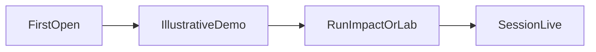

# إصلاح ترتيب KPI والمخطط الأفقي والبيانات التوضيحية

## المشكلة

1. في [`overview-view.tsx`](components/causaseal/overview-view.tsx) المخططات تُرسم قبل صف الـ Stat (تهديدات / بصمات / دقة / زمن)، فالربع الإحصائي ينزل تحت الشاشة الأولى.
2. [`chart-bar-horizontal.tsx`](components/chart-bar-horizontal.tsx) يعتمد `YAxis` من Recharts بعرض ثابت 120px واتجاه LTR؛ الأسماء العربية الطويلة في الذاكرة والتقارير تنقص وتتشوه.
3. المخططات والأرقام تظهر فقط بعد `hasSession` / تشغيل الأثر؛ المحكّم يفتح صفحة فارغة («لم تبدأ التجربة») بلا حافز للضغط.

## القرار الثابت

- **ترتيب مركز العمليات:** العنوان ← صف الـ KPI الأربعة ← المخططات ← باقي المحتوى.
- **المخطط الأفقي المكسور:** لا نصلحه بـ Recharts YAxis. نستبدل استخدامه في الذاكرة والتقارير بـ **أعمدة عمودية قصيرة التسمية** (`ChartBarMultiple` بسلسلة واحدة) حيث التسمية على المحور X قصيرة والتسمية الكاملة في التلميح؛ وللتقارير نُبقي الرادار ونستبدل الأفقي ببطاقة **أشرطة Progress** (نفس نمط المقاييس الموجود أصلًا، قابل للقراءة بالعربية بالكامل) لأن أسماء المقاييس الستة طويلة جدًا لمحور X.
- **بيانات أول فتح:** بيانات توضيحية ثابتة الشكل (ليست ادعاء 90٪/99٪)، مع `IllustrativeBadge`. عند وجود جلسة حقيقية تُستبدل فورًا بأرقام الجلسة وشارة «أرقام هذه الجلسة».

---

## المرحلة 1 — مركز العمليات: KPI أولًا + بيانات توضيحية

الملف: [`components/causaseal/overview-view.tsx`](components/causaseal/overview-view.tsx)

- انقل كتلة `grid … xl:grid-cols-4` الخاصة بـ Stat لتأتي مباشرة بعد `PageHeading` (وقبل المخططات).
- عند `!live`: اعرض نفس الأربع بطاقات بقيم من بذرة توضيحية (مثل منع 4، بصمات 3، مطابقة 75٪، زمن 42ms) + `IllustrativeBadge` في العنوان؛ لا تُبقِ `Empty` بدل الصف.
- المخططات تُعرض دائمًا: إن وُجدت أحداث جلسة استخدمها؛ وإلا استخدم سلسلة توضيحية من [`lib/chart-demo.ts`](lib/chart-demo.ts) (جديد).
- الـ Alert يبقى دعوة للتشغيل، دون إخفاء الأشكال.

---

## المرحلة 2 — استبدال المخطط الأفقي المكسور

### الذاكرة — [`memory-view.tsx`](components/causaseal/memory-view.tsx)

- احذف `ChartBarHorizontal`.
- ضع `ChartBarMultiple` بـ `showSeriesB={false}`، وفئات قصيرة مشتقة من الثوابت (مثل «إرسال»، «حساسة»، «وجهة»، «مسترجع»، «صلاحية») عبر مساعد جديد في [`lib/chart-session.ts`](lib/chart-session.ts)؛ القيمة = عدد البصمات؛ التلميح يعرض الاسم الكامل.
- أبقِ الدونات كما هي.

### التقارير — [`reports-view.tsx`](components/causaseal/reports-view.tsx)

- احذف `ChartBarHorizontal`.
- أبقِ `ChartRadarDots` للملف السداسي.
- بجانبه (أو تحته في عمود واحد على الموبايل): بطاقة «مقاييس الجلسة» بأشرطة `Progress` + النسبة كاملة بالعربية (نفس بيانات `metrics` / البذرة التوضيحية). هذا يزيل التشوه دون الاعتماد على محور Recharts.

### تنظيف

- إن لم يعد `ChartBarHorizontal` مستخدمًا في أي صفحة: احذف [`components/chart-bar-horizontal.tsx`](components/chart-bar-horizontal.tsx) أو حوّله لـ re-export غير مستخدم — الأفضل الحذف لتجنب إعادة الاستخدام الخاطئ.

---

## المرحلة 3 — طبقة بيانات توضيحية تنتقل للجلسة

ملف جديد: [`lib/chart-demo.ts`](lib/chart-demo.ts)

محتوى ثابت الشكل (قيم معقولة، ليست تسويقًا):

- `DEMO_EVENTS` — ~8–12 حدثًا بأوقات وحالات منع/سماح/تحقق (امتداد منطقي لـ [`SEED_EVENTS`](lib/seed-data.ts))
- `DEMO_SESSION_STATS` — blocked / fingerprintCount / matchRate / lastLatencyMs / riskScore
- `DEMO_METRICS` — نفس ستة تسميات `/api/reports/metrics` بقيم بين 0 و 1
- `DEMO_LAB_RESULTS` + `DEMO_LAB_SCORE` — طفرات جاهزة لخط التشابه والدونات والراديال
- `DEMO_IMPACT_ROWS` — خمسة صفوف هارنس/بصمة تطابق سيناريو الأثر

قاعدة العرض في كل صفحة:

| الصفحة | قبل التشغيل | بعد التشغيل |
| --- | --- | --- |
| مركز العمليات / مراقبة / تقارير | demo + IllustrativeBadge | أحداث/ملخص الجلسة |
| الأثر | مخططات من `DEMO_IMPACT_ROWS` فوق الزر | `rows` الحقيقية بعد التشغيل |
| المختبر | مخططات من `DEMO_LAB_*` فوق الإعداد | `results` / `score` بعد التوليد |
| التحليل | يبقى فارغًا حتى نتيجة (التفاعل هنا هو النموذج نفسه) | رادار/راديال بعد التحليل |
| الذاكرة | كما الآن من البصمات (بذور حقيقية) | كما هي |

لا تُمزج أحداث البذرة مع `listEvents` في الخادم (القاعدة الحالية في telemetry تبقى). الديمو واجهة فقط حتى `hasSession` / `results.length` / `rows.length` / `fromSession`.

---

## المرحلة 4 — ربط الصفحات المتبقية

- [`monitor-view.tsx`](components/causaseal/monitor-view.tsx): إن `events.length === 0` اعرض مخططات من `DEMO_EVENTS` مع شارة توضيحية؛ الجدول يبقى فارغًا أو يعرض تنويهًا أن الجدول للجلسة الحية فقط.
- [`impact-view.tsx`](components/causaseal/impact-view.tsx): اعرض مخططات الديمو قبل التشغيل؛ بعد التشغيل استبدلها بـ `rows`.
- [`lab-view.tsx`](components/causaseal/lab-view.tsx): اعرض مخططات الديمو قبل «توليد…»؛ بعد التشغيل استبدلها؛ قائمة النتائج تبقى Empty حتى التشغيل حتى يتضح الفرق بين شكل توضيحي ونتيجة حقيقية.
- [`reports-view.tsx`](components/causaseal/reports-view.tsx): عند `!fromSession` اعرض رادار + Progress من `DEMO_METRICS` مع الشارة التوضيحية الموجودة أصلًا.

---

## ما لا يتغير

- لا أرقام تسويق 90٪/99٪ في النصوص.
- لا خلط بذور في `engine/telemetry.mjs` live feed.
- لا تغيير محرك القرار.
- ألوان Soft `--chart-*` كما هي.

## تحقق

1. فتح `/` بدون تشغيل: KPI ظاهرة في أول الشاشة + مخططات + شارة توضيحية.
2. الذاكرة والتقارير: لا نص عربي مقطوع داخل محور.
3. تشغيل الأثر ثم الرجوع لمركز العمليات: الأرقام والمخططات تتحول لجلسة حقيقية والشارة تتغير.
4. المختبر: مخططات ظاهرة قبل الضغط؛ بعد التوليد تتحدث القائمة والمخططات.