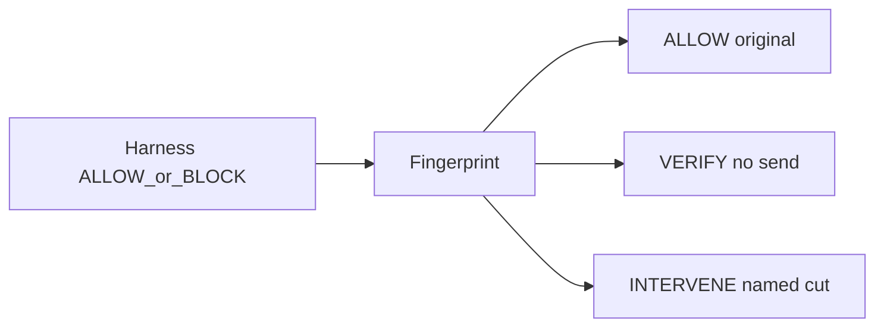

# أربع حالات وقطع مسمّى قبل الرفع

الفرع الذي يُرفع هو `main` (هذا المستودع ينشر منه إلى Hostinger). لا فرع جديد ولا PR.

النقلة تبقى فوق الهارنس: الهارنس ما زال ALLOW/BLOCK على النداء الحالي بلا ذاكرة. الإضافات الثلاث تُظهر القطع، الحالة الرابعة، وجملة التسجيل.

## 1. قطع مسمّى، والأصل لا يخرج

في [`engine/ops-agent.mjs`](engine/ops-agent.mjs) أضف `causalCut(invariants)` بأولوية واحدة: «تعليمة في النص المسترجع»، ثم «وجهة غير معتمدة»، ثم «بيانات حساسة»، ثم «صلاحية مرتفعة». تجاهل «أداة إرسال» لأنها شكل النداء وليست العلاقة الخطرة.

عند `INTERVENE` أرجع `cut` مع النتيجة. [`redactSensitive`](engine/ops-agent.mjs) يبقى يمسح الحمولة الحساسة والنص المسترجع — اختبارات «لا أصل» في [`test/gateway.test.mjs`](test/gateway.test.mjs) و[`test/connectors-service.test.mjs`](test/connectors-service.test.mjs) تبقى. جملة النسخة المحذوفة تذكر اسم القطع (`قُطعت: …`). لا نرسل أسرارًا لأننا «قطعنا ثابتًا واحدًا» فقط.

عمود جديد «القطع» في جدول المقارنة على [`components/causaseal/architecture-view.tsx`](components/causaseal/architecture-view.tsx) و[`components/causaseal/impact-view.tsx`](components/causaseal/impact-view.tsx). صف الصياغة المتغيرة يعرض اسم الثابت. مرّر `cut` من [`lib/api/client.ts`](lib/api/client.ts).

## 2. الصف الرابع: راقب ولا تمنع

ثبّت `PARTIAL` في [`engine/fixtures/novel-leak.mjs`](engine/fixtures/novel-leak.mjs): أداة إرسال معروفة، بيانات حساسة، وجهة معتمدة، بلا تعليمة في المسترجع. القواعد في [`engine/gateway.mjs`](engine/gateway.mjs) تعطي `VERIFY`. الهارنس `ALLOW` لأن الوجهة معتمدة. Jaccard ضد بذور التسريب يبقى تحت `0.6` حتى لا ينقلب الصف إلى `INTERVENE` — الاختبار يثبت ذلك.

`kind: "partial"` في `runOpsAgent`، ونوع العميل، وقائمة أدوات MCP في [`connectors/mcp-server.mjs`](connectors/mcp-server.mjs). لا إرسال عند VERIFY (السلوك الحالي: التسليم فقط لـ ALLOW وINTERVENE).

أضف الصف إلى [`HARNESS_COMPARE_KINDS`](lib/architecture.ts) بعنوان «بداية جزئية». الجملة: الهارنس يسمح، البصمة تراقب، لا إرسال. عنوان البطاقة يصير «أربع حالات». شارة VERIFY ليست شارة المنع.

## 3. جملة التسجيل تطابق الديمو

استبدل [`HARNESS_DIFF`](lib/nav.ts) بهذه الجملة، وهي نفسها نص النموذج:

> نركب فوق هارنس الوكيل. الهارنس يحكم على الأداة الحالية. نحن نحفظ سبب الحادث السابق، نعرفه إذا رجع بشكل جديد، ونقطع تلك العلاقة والمهمة تكمل.

ملف قصير [`docs/نص-التسجيل.md`](docs/نص-التسجيل.md) للصق في نموذج سيف: الجملة، جدول الحالات الأربع، وممنوع رفع 90٪ و99٪ و«أول في العالم» و«مناعة سيادية». حدّث سكربت [`docs/runbook-لجنة.md`](docs/runbook-لجنة.md) ليشمل الصف الرابع وعمود القطع. لا إعادة كتابة [`docs/فكرة-CAUSASEAL-SERMG.md`](docs/فكرة-CAUSASEAL-SERMG.md)؛ التحذير الموجود فيه يبقى، ويُشار إلى نص التسجيل كالنص الوحيد للرفع.

## إثبات ثم إصدار

- `npm test` يغطي: mutated ما زال ALLOW/INTERVENE/لا أصل ومعه `cut`؛ partial = ALLOW/VERIFY/لا إرسال ومن دون تطابق بصمة.
- في المتصفح: زر «شغّل مقارنة الهارنس» على `/architecture` و`/impact` يملأ أربعة صفوف، وصف الصياغة المتغيرة يظهر اسم القطع.

كومِتات منفصلة على `main`:

- `feat(engine): name the causal cut on intervene without sending the original`
- `feat(demo): add partial VERIFY row to the harness compare`
- `docs: registration sentence matches the four-case demo`

ثم قص **0.10.0** (ميزة متوافقة للخلف): [`CHANGELOG.md`](CHANGELOG.md) قسم Added للجملة والصف والقطع، [`package.json`](package.json) من `0.9.1`، روابط المقارنة، كومِت `chore(release): cut 0.10.0`، وسم `v0.10.0`، ثم `git push origin main` والوسم. `[Unreleased]` يبقى فارغًا.