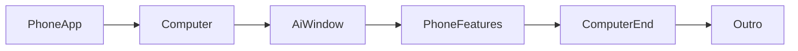

# فيلم الإطارات: نفس المحتوى، حركة احترافية

المحتوى اللي عجبك يبقى: البطاقات، الجمل، وترتيب المشاهد الـ13 في [brag-output/composition/index.html](brag-output/composition/index.html). اللي يتغير هو الطبقة البصرية. الحركة الحالية كلها `opacity` مع `y` بين 16 و28 بكسل، والبطاقة تطفو في فراغ أبيض. ما في إطار جهاز ولا شخصية.

الفيلم الحالي يبقى كما هو. النسخة الجديدة تُبنى في `brag-output-frames/` حتى ما نمسح `motion-graphics.mp4`.

## السكربت أولًا

نحدّث [brag-output/brag-plan.md](brag-output/brag-plan.md) و[brag-output/composition-brief.md](brag-output/composition-brief.md) بنسخة في المجلد الجديد، ونضيف لكل مشهد ثلاثة حقول: الإطار، الشخصية، محور الدخول.

الجمل الممنوعة تبقى ممنوعة: 90٪، 99٪، مناعة سيادية، Entra / EHR / SIEM كأنها شغّالة. القطع على الشاشة للصفّين اللي فيهما `INTERVENE` هو **«تعليمة في النص المسترجع»** كما في [engine/ops-agent.mjs](engine/ops-agent.mjs)، مو «ثابت مسمّى». جملة الواجهة **«الأصل لا يُرسل»**.

## أربع إطارات

إطارات CSS ثابتة الميل (حوالي 8°)، بلا لفّ وبلا لمعة زجاج. البطاقة الحالية تُرسم **داخل الشاشة**، مو بدل الإطار.

- **جوال التطبيق** — الهوك والاسم: `ALLOW` ثم `INTERVENE` داخل شاشة الجوال.
- **الميزات داخل جوال** — الأثر والموصّلات: البطاقات الثلاث (HTTP · MCP · SDK) والقطع المحذوف داخل شاشة الجوال.
- **داخل ذكاء اصطناعي** — التحقيق والذاكرة ومختبر SERMG داخل نافذة وكيل (ترويسة صغيرة «وكيل» + البطاقة).
- **داخل كمبيوتر** — العمليات، المعمارية، جدول المقارنة، المراقبة، والتقارير. جدول الأربع حالات يملأ شاشة اللابت حتى يبقى مقروءًا.

## شخصيتان

رسم SVG مسطّح بألوان Soft (`#1b8354` على `#fcfcfd`)، بلا وجوه فوتوغرافية وبلا ماسكوت جاهز.

- **الوكيل:** يطلع من تحت بجانب الجهاز في مشاهد الإرسال (الهوك، الجدول، نافذة الذكاء).
- **الختم:** يطلع من تحت لحظة `INTERVENE` ويمسك صف الصياغة المتغيرة، ثم ينزل تحت في الخروج.

ما يتكلمان جملًا جديدة. وجودهما حركة فقط.

## الحركة

نفس تتابع البطاقات (ظهور متدرّج)، بس المسافة تصير من خارج الإطار:

- العنوان والسطر يدخلان **من فوق** (`y: -48` → `0`، حوالي 0.4s، `power3.out`).
- البطاقة والجهاز والشخصية يدخلون **من تحت** (`y: 72` → `0`، حوالي 0.55s، `power3.out`)، بتأخير حوالي 0.1s بين العناصر.
- قبل القطع: اللي جاء من فوق يطلع فوق، واللي جاء من تحت ينزل تحت (حوالي 0.2s). ممنوع تلاشي مشهدين فوق بعض.

توزيع المشاهد على الإطارات، بنفس المدد الحالية (64 ثانية):

- 0–8s جوال التطبيق: الهوك ثم الاسم.
- 8–32s كمبيوتر: العمليات، المعمارية، ثم جدول المقارنة (الختم على الصف الأول).
- 32–44s نافذة الذكاء: شكل الثوابت، الذاكرة، مختبر SERMG.
- 44–54s جوال الميزات: الأثر ثم HTTP / MCP / SDK.
- 54–61s كمبيوتر: المراقبة ثم التقارير.
- 61–64s خروج الأجهزة والشخصيتين لتحت، والنطاق مع «الأصل لا يُرسل» من فوق.

## التنفيذ

- تركيب HTML جديد في `brag-output-frames/composition/` يعيد استخدام خطوط IBM Plex والألوان والبطاقات من التكوين الحالي.
- `npx hyperframes check` داخل التكوين، ثم تصيير `brag-output-frames/motion-graphics.mp4`.
- مراجعة لقطات: الهوك داخل الجوال، الجدول داخل اللابت، وصف `INTERVENE` يقرأ «تعليمة في النص المسترجع»، وما في سطر 90٪.
