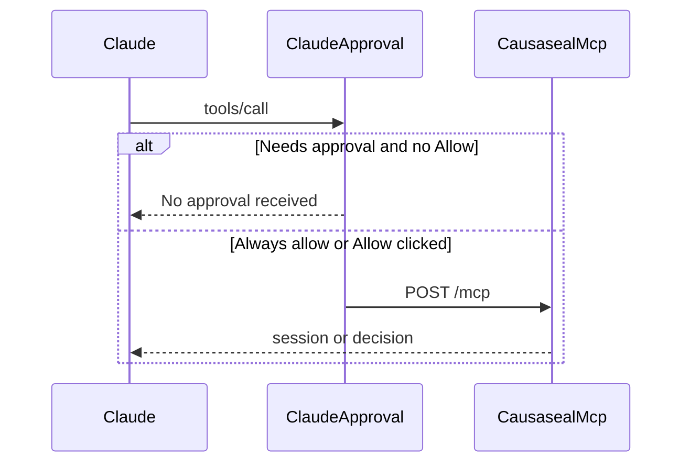

# أسماء MCP بالإنجليزي وخطأ الموافقة

لا نلمس ملفات `docs/` (بما فيها [docs/registration-copy.md](docs/registration-copy.md)). الشغل في خادم MCP وصفحة الموصّل فقط.

## الخطأ: الطلب ما وصل السيرفر

النص **"No approval received"** غير موجود في المستودع. [server.js](server.js) و[connectors/mcp-server.mjs](connectors/mcp-server.mjs) بلا OAuth وبلا مفتاح وبلا طابور موافقة لكل `orgId`. أي جهة جديدة (`demo` أو `saif-test`) تشتغل فورًا.

كلود يحجب `tools/call` عنده قبل ما يرسل HTTP، إذا أداة في وضع **Needs approval** وما انضغط Allow (أو انتهت مهلة البطاقة). هذا يفسّر إن الخمس أدوات رجّعت نفس النص: `tools/list` نجح (شاف الأدوات)، والاستدعاء نفسه ما خرج من كلود. لوقات السيرفر وقت هالمحاولات تكون فاضية — مو دليل إن الطلب انحبس عند handler.

ما نضيف approval على السيرفر. إضافته تصنع المشكلة اللي كلود ظنها موجودة.

قبل يوم اللجنة، في كلود: Customize ثم Connectors ثم causaseal ثم Tool permissions، واختار **Always allow** لقراءة ولكتابة. بعد أي تغيير لقائمة الأدوات لازم تعيد السماح. هذا مو شيء نقدر نطفّيه من الكود.

## أسماء الأدوات

حقل `name` أصلًا إنجليزي (`causaseal_get_session` …). اللي يظهر في شاشة Read / Write عند كلود هو **`title`** وهو عربي اليوم في [connectors/mcp-server.mjs](connectors/mcp-server.mjs).

- `title` لكل أداة من العشر: إنجليزي قصير (مثل `Org session summary`).
- `description`: فقرة عربية ثم فقرة إنجليزية، نفس المعنى. أوصاف الحقول في الـschema ثنائية اللغة كذلك.
- نص الرد (`content` markdown): سطر عربي ثم سطر إنجليزي، عشان قارئ اللجنة والفريق يفهمون الناتج.
- أسماء البروتوكول تبقى `causaseal_*` كما هي حتى ما ينكسر [test/connectors-mcp.test.mjs](test/connectors-mcp.test.mjs) و[lib/connectors.ts](lib/connectors.ts).

## إثبات إن السيرفر يستجيب

نوسّع اختبار MCP الحالي: `tools/call` لـ `causaseal_get_session` و`causaseal_list_compliance` **بدون** ترويسة Authorization، ونؤكد إن النص الراجع مو `No approval received` وفيه بيانات جلسة. هذا يفصل بوابة كلود عن المحرك.

على صفحة [components/causaseal/connectors-mcp-view.tsx](components/causaseal/connectors-mcp-view.tsx) نضيف سطرًا واحدًا: الرابط بلا مفتاح، وخطأ No approval received يُحل من صلاحيات كلود (Always allow) مو من `orgId`.

## جواب اللجنة (لسانًا، مو ملف جديد)

كلود صح في التقييم: الصدق والجدول الرباعي فوق متوسط الهاكاثون، والفوز يتقرر في دقيقة «ليش فوق الهارنس». تشخيصه للسيرفر غلط.

- **مو قاموس كلمات.** [engine/xcfs.mjs](engine/xcfs.mjs) يطلع ثوابت من شكل النداء: أداة إرسال، بيانات حساسة، وجهة غير معتمدة، تعليمة داخل النص المسترجع (مو في طلب المستخدم)، صلاحية مرتفعة. تغيير الصياغة ما يغيّر المجموعة. صف lookalike يثبت إن كلامًا قريبًا ومشروعًا يبقى ALLOW.
- **ليش 0.6 مو adaptive.** Jaccard = تقاطع الثوابت ÷ اتحادها. 0.6 يعني أغلب السبب نفسه مو كل التسمية. ثابتة عشان الحالات الأربع تتكرر أمام المحكّم؛ العتبة المتعلّمة تحتاج سجلًا موسومًا ما عندنا. صف partial يبقى تحت 0.6 فيصير VERIFY مو INTERVENE. قولوا: نقطة تشغيل مختارة، مو أمثل مُتعلَّم.
- **false positive حقيقي.** عندنا حالة lookalike مصممة تسمح. ما قسنا معدل خطأ على سجل مؤسسة خارجي. هذا الجواب الجاهز.
- **ليش طبقة مو داخل الهارنس.** الهارنس يحكم: هل هذا النداء مسموح الآن. ما يحفظ ذاكرة الجهة لشكل حادث سابق بعد تغيير اسم الأداة. الطبقة واحدة أمام HTTP وMCP وSDK. صف known leak: الهارنس BLOCK. صف mutated: الهارنس ALLOW والبصمة INTERVENE. لو انحطت الذاكرة داخل هارنس واحد، كل تشغيل وكيل يعيد بناءها.
