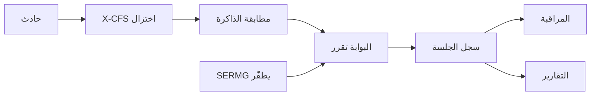

# خطة MVP: الحلقة السببية السبع

**نسبة البداية:** 35 من 100. **الهدف بعد التنفيذ:** حوالي 65 من 100 (MVP يُعرض، ليس منتجًا سياديًا).

لا صفحات جديدة. لا Supabase. التخزين يبقى في ذاكرة عملية Node داخل [`engine/`](engine/) و[`server.js`](server.js) كما هو اليوم.

## 0. توثيق قرار قاعدة البيانات

في أول [`docs/مطابقة-الفكرة-مع-الكود.md`](docs/مطابقة-الفكرة-مع-الكود.md) بعد سطر النسبة:

- قاعدة بيانات سحابية (مثل Supabase) **غير مطلوبة** لـ MVP سيف ولا لمعايير التحكيم.
- الذاكرة الحالية في العملية كافية لعرض حي قابل للتكرار.
- التخزين الدائم مؤجَّل لما بعد التأهل / المعرض في نوفمبر إن لزم.

## 1. اختزال X-CFS الحقيقي

الملف: [`engine/xcfs.mjs`](engine/xcfs.mjs) (اليوم يعيد `reductionRatio: 0.91` ثابتًا و`illustrative: true`).

- بناء جراف موسَّع من الحادث: عقد سببية (مصدر، تأثير قرار، أداة، صلاحية، بيانات، وجهة) + عقد «تضخم سجلات» غير حرجة (وقت، معرّف طلب، لغة، إصدار أداة) تمثّل عبء المسارات في الفكرة.
- تقليم تراجعي بسيط: الإبقاء فقط على العقد/الحواف اللازمة لتفسير الخرق (الثوابت السببية).
- الناتج: `invariants[]`، `keptNodes`، `prunedCount`، `reductionRatio` محسوب فعلًا (`1 - kept/total`).
- إظهار قبل/بعد في [`components/causaseal/investigate-view.tsx`](components/causaseal/investigate-view.tsx) بجانب `CausalPath`.
- توسيع العقود في [`engine/contracts.mjs`](engine/contracts.mjs) / [`lib/contracts.ts`](lib/contracts.ts): `invariants` على البصمة، و`reduction` داخل نتيجة التحليل. إسقاط `illustrative: true` الإلزامي عن نتيجة الاختزال عندما يكون الحساب حقيقيًا.

## 2. مطابقة البصمة من الذاكرة

الملف: [`engine/memory.mjs`](engine/memory.mjs) (بحث نصي فقط اليوم).

- تخزين `invariants` مع كل بصمة (البذور الثلاث تأخذ ثوابت معروفة: تسريب / تصعيد صلاحيات / تسميم ذاكرة).
- مطابقة Jaccard على مجموعة الثوابت (عتبة واضحة، مثل 0.6). عند التطابق: إرجاع `id` و`score` وزيادة `matches`.
- البوابة تستخدم هذه المطابقة بدل النص الثابت `"X-CFS-001"` عند كلمة «تجاهل».
- صفحة [`memory-view.tsx`](components/causaseal/memory-view.tsx) تعرض الثوابت وعدد المطابقات المحدَّث.

## 3. SERMG يولّد طفرات ويعيد `/api/analyze`

الملف: [`engine/sermg.mjs`](engine/sermg.mjs) (عناوين جاهزة اليوم). المسار: `POST /api/sermg/run` في [`server.js`](server.js).

- قراءة البصمة وخيارات المختبر (`changePrompt` / `changeTool` / `changeData` / `changePrivilege`) الممرَّرة اليوم من الواجهة لكن **غير مستخدمة** في المحرك.
- توليد حوادث متحوّلة الشكل مع الإبقاء على الثوابت الخطرة، ثم استدعاء `analyze()` لكل طفرة.
- طفرة أخيرة حميدة (وجهة معتمدة، بلا بيانات حساسة) لإظهار `ALLOW`.
- `score` = نسبة الطفرات الخطرة التي صارت `INTERVENE` أو `VERIFY` (وليس رقم 0.91 المزيف).
- [`lab-view.tsx`](components/causaseal/lab-view.tsx) يمرّر صناديق الاختيار إلى الـ API ويعرض النتيجة الحقيقية.

## 4. البوابة تقرأ الذاكرة قبل القرار

الملف: [`engine/gateway.mjs`](engine/gateway.mjs).

ترتيب القرار:

1. اختزال X-CFS واستخراج الثوابت.
2. مطابقة الذاكرة. إن وُجد تطابق ومسار خطر → `INTERVENE` مع `matchedSignature`.
3. وإلا محرك القواعد الحالي، ثم OpenAI إن وُجد المفتاح.
4. بعد القرار: كتابة حدث في سجل الجلسة. عند `INTERVENE` يمكن حفظ/تحديث البصمة تلقائيًا إن لم تُحفظ يدويًا.

هذا يحقق جملة الفكرة: نتذكر السبب اليوم فنمنع إعادة تشكّله.

## 5. المراقبة ومركز العمليات من الجلسة

[`engine/telemetry.mjs`](engine/telemetry.mjs) اليوم يعيد `SEED_EVENTS` فقط.

- `recordEvent()` يضيف أحداث التحليل/الطفرات في مقدمة القائمة.
- `GET /api/events` يعيد أحداث الجلسة ثم البذور.
- [`monitor-view.tsx`](components/causaseal/monitor-view.tsx): تحديث دوري خفيف حتى يظهر الحدث بعد التحليل دون إعادة تحميل.
- [`overview-view.tsx`](components/causaseal/overview-view.tsx): المقاييس الأربعة تُحسب من الجلسة (تهديدات مُنعت، عدد البصمات، نسبة المطابقة، آخر زمن تحليل). شارة «هذه الجلسة» بدل الاكتفاء بـ «بيانات توضيحية» عندما يوجد نشاط.

## 6. التقارير من نفس الجلسة

`GET /api/reports/metrics` في [`server.js`](server.js) أرقام ثابتة اليوم.

- حساب من سجل الجلسة: دقة المطابقة، نسبة المنع للمسارات الخطرة، نسبة السماح الصحيح، عدد الطفرات المكتشفة.
- سجل القرارات = آخر أحداث الجلسة لا `DECISION_LOG` الثابت في [`reports-view.tsx`](components/causaseal/reports-view.tsx).
- تسمية صريحة: **أرقام هذه الجلسة** — ليست ادعاءً علميًا عالميًا (يتوافق مع [`docs/سيف.md`](docs/سيف.md) معيار التحقق والإثبات 15٪).

## 7. زر عرض الهاكاثون (ثلاث دقائق)

زر واحد على صفحة التحليل [`investigate-view.tsx`](components/causaseal/investigate-view.tsx) (وربط اختياري من مركز العمليات): **تشغيل عرض SAIF**.

ثلاث خطوات متتالية على الصفحات الموجودة:

1. حادثة تسريب → تحليل → `INTERVENE` → حفظ بصمة.
2. نفس السبب بصيغة/أداة مختلفة → مطابقة نفس `X-CFS-*`.
3. سياق مشروع → `ALLOW`.

بدون هذا الزر العرض يرتبك أمام اللجنة.

## خارج النطاق (متعمد)

- Supabase / Postgres / Auth / RLS
- embeddings أو Graph Edit Distance البحثي
- اعتراض وكيل إنتاج حي (بروكسي)
- وحدات امتثال NCA/OWASP كمنتج
- ادعاء ASR ≈ 0

## تحقق

- مسار يدوي: تحليل → ذاكرة → مختبر → مراقبة → تقارير تتحدث من نفس الحوادث.
- زر العرض يكمل الثلاث خطوات دون أخطاء.
- البناء الحالي يبقى: `next build` تصدير `out/` + `server.js` على Hostinger. لا تغيير preset.

## توثيق بعد التنفيذ

تحديث النسبة في أول [`docs/مطابقة-الفكرة-مع-الكود.md`](docs/مطابقة-الفكرة-مع-الكود.md) وعلامات `[x]` للبنود السبعة المنفَّذة كمنطق جلسة.