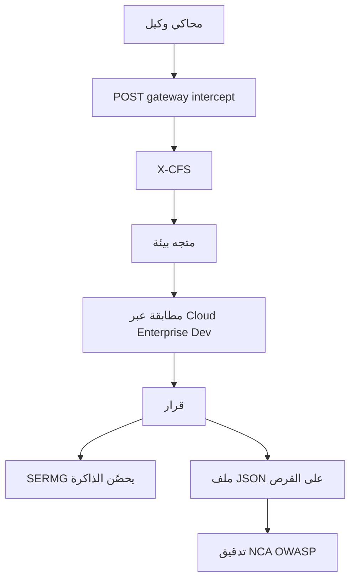

# من 65 إلى 100: إغلاق ركائز الفكرة

**الآن:** حلقة الجلسة تعمل (اختزال، مطابقة Jaccard، SERMG يعيد التحليل، قرار، مراقبة، تقارير، عرض SAIF). النسبة 65.

**معنى 100٪ هنا:** كل ركيزة في [`docs/فكرة-CAUSASEAL-SERMG.md`](docs/فكرة-CAUSASEAL-SERMG.md) لها منطق يعمل أمام اللجنة. ليس شبكة سيادية على قطاعات المملكة، وليس ادّعاء ASR ≈ 0 كرقم علمي.

لا صفحات منتج جديدة إلا لو احتاج العرض شريط بيئات على الصفحات الحالية. لا Supabase. النشر يبقى `out/` + [`server.js`](server.js).

## المرحلة أ — 65 إلى 80: عبر السياقات + تحصين

**ذاكرة عابرة للسياقات (بدون embeddings سحابية)**  
توسيع البصمة في [`engine/memory.mjs`](engine/memory.mjs) و[`engine/contracts.mjs`](engine/contracts.mjs) بحقل `environment`: `cloud` | `enterprise` | `dev`.  
مطابقة على الثوابت أولًا (Jaccard كما اليوم)، ثم مسافة رسم بسيطة على عقد [`engine/xcfs.mjs`](engine/xcfs.mjs) المحفوظة (عدد العقد المشتركة / تعديل التسميات السطحية مثل اسم الأداة). اكتشاف في بيئة جديدة = نفس الثوابت، بيئة مختلفة.  
واجهة [`memory-view.tsx`](components/causaseal/memory-view.tsx) و[`lab-view.tsx`](components/causaseal/lab-view.tsx): اختيار البيئة؛ عند المطابقة تظهر «اكتُشف في التطوير، مُنع في السحابة».

**SERMG: تنبّأ → امنع → حصّن**  
بعد كل طفرة خطرة اكتُشفت في [`engine/sermg.mjs`](engine/sermg.mjs): إن لم تُحفظ البصمة تُكتب تلقائيًا (لقاح). الطفرات التالية في نفس التشغيل تُمنع من الذاكرة لا من القواعد فقط. هذا يغلق «التحديث المستمر» دون نموذج توليدي ثقيل.

## المرحلة ب — 80 إلى 92: بوابة حية + أثر دائم

**اعتراض تشغيل (محاكي وكيل، لا بروكسي إنتاج)**  
`POST /api/gateway/intercept` في [`server.js`](server.js) يستقبل استدعاء أداة كما يرسله وكيل: `{ agent, tool, prompt, untrustedContent, environment, ... }` ويستدعي [`analyze`](engine/gateway.mjs) قبل «التنفيذ».  
محاكي صغير على صفحة المراقبة [`monitor-view.tsx`](components/causaseal/monitor-view.tsx): أزرار «وكيل يحاول التسريب / وكيل مشروع» ترسل للاعتراض. الجدول يحدَّث من الجلسة. هذا يحقق Runtime Causal Gateway أمام اللجنة بدون LangChain خارجي.

**تخزين دائم خفيف**  
ملف `data/causaseal-state.json` تقرأه/تكتبه [`engine/memory.mjs`](engine/memory.mjs) و[`engine/telemetry.mjs`](engine/telemetry.mjs) (بصمات + آخر أحداث الجلسة). يبقى بعد إعادة تشغيل Hostinger. ليس Postgres. يُضاف إلى `.gitignore` إن احتوى بيانات عرض محلية؛ البذور تُعاد إن الملف فُقد.

## المرحلة ج — 92 إلى 100: إثبات وامتثال وصدق الأرقام

**امتثال كمنطق لا كجدول ثابت**  
[`engine/compliance.mjs`](engine/compliance.mjs) يفحص الجلسة: وجود سجل قرارات، INTERVENE عند بيانات حساسة + وجهة غير معتمدة، بصمة تسميم ذاكرة. الحالات تصبح `mapped` عند توفر الدليل، وتبقى `planned` لاعتراض وكيل إنتاج حقيقي فقط. صفحة التقارير تعرض الحالة المحدَّثة.

**قياس الجلسة / ROI المعروض**  
[`GET /api/reports/metrics`](server.js) يضيف: نسبة الاختزال المتوسطة من `reduction.reductionRatio`، زمن القرار، وعدد البيئات التي اكتسبت المناعة. يبقى الوسم **أرقام هذه الجلسة**. لا نكتب ASR ≈ 0 في الواجهة كحقيقة؛ نكتب هدف الفكرة في التوثيق فقط.

**توثيق المطابقة**  
تحديث كامل لـ [`docs/مطابقة-الفكرة-مع-الكود.md`](docs/مطابقة-الفكرة-مع-الكود.md): النسبة 100، تصحيح الفقرات القديمة التي ما زالت تصف `dashboard.html` والـ stubs، ونقل البنود المغلقة إلى `[x]`. الإبقاء صريحًا على ما لن يُنفَّذ لأنه خارج المنتج المعروض: embeddings عصبية، Postgres، اعتراض أسطول وكلاء إنتاج، توسّع قطاعي وطني.

## خارج النطاق (حتى عند 100٪ الفكرة المعروضة)

- Supabase / Auth / RLS
- نماذج embeddings جاهزة أو Graph Edit Distance البحثي الثقيل
- وكيل إنتاج حقيقي مربوط بأداة خارجية
- ادّعاء علمي ASR ≈ 0 أو دقة 99%+ خارج الجلسة

## تحقق

- بصمة تُحفظ في `dev` ثم حادث بنفس الثوابت في `cloud` يُمنع.
- SERMG يضيف بصمة ثم طفرة لاحقة تُمنع بالمطابقة.
- محاكي المراقبة: تسريب → INTERVENE يظهر فورًا في الجدول والتقارير.
- إعادة تشغيل `server.js` تُبقي البصمات من الملف.
- `next build` + `server.js` كما هما على Hostinger.