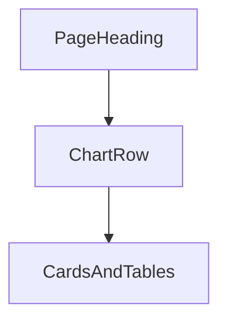

# مخططات الجلسة في بداية كل صفحة

الرسوم موجودة أصلًا كبنية: [`components/ui/chart.tsx`](components/ui/chart.tsx) مثبّت، وألوان `--chart-1` إلى `--chart-5` في [`app/globals.css`](app/globals.css) مربوطة بأخضر الهوية (`--sa-600` … `--sa-300`). العمل ليس بناء Recharts من الصفر. نسحب البلوك الجاهز، نبدّل `chartData` و`chartConfig` والعناوين، ونركّبه تحت `PageHeading` مباشرة. البطاقات والجداول الحالية تبقى تحت المخططات.

## قاعدة البيانات

لا سلسلة زوار وهمية من مثال الشادن (desktop/mobile لثلاثة أشهر). المخطط يقرأ نفس مصادر الصفحة:

- الجلسة: `fetchSession()` / `sessionSummary` في [`engine/telemetry.mjs`](engine/telemetry.mjs)
- الأحداث: `fetchEvents()` وحقول `status` و`time` و`label`
- الأثر: صفوف `runOpsAgentClient` (هارنس مقابل البصمة، نسخة محذوفة مقابل أصل)
- التحليل: `AnalysisResult.reduction` والثوابت الستة من [`engine/xcfs.mjs`](engine/xcfs.mjs)
- الذاكرة: `fetchFingerprints()` (البذور الثلاث في [`lib/seed-data.ts`](lib/seed-data.ts) لها توزيع بيئات وثوابت حقيقي، ومطابقاتها صفر فلا تُرسم)
- المختبر: `MutationResult.similarity` و`outcome` و`score`
- التقارير: مصفوفة `metrics` من `GET /api/reports/metrics`

إذا الجلسة فارغة يبقى `Empty` / `Alert` الحالي، والمخطط لا يُرسم. بعد «تشغيل سيناريوهات الفرق» أو عرض SAIF تمتلئ المخططات. هذا يحافظ على قاعدة «لا أرقام مزروعة».

## السحب من CLI (مرة واحدة)

`chart` مثبّت. البلوكات التي تُسحب، كلها من `@shadcn`:

```bash
npx shadcn@latest add chart-area-interactive chart-pie-donut chart-radial-text chart-radar-dots chart-bar-multiple chart-bar-horizontal chart-line-linear
```

كل بلوك ملف واحد (مثل `chart-area-interactive.tsx`). بعد السحب، التعديل الوحيد داخل الملف:

- حذف مصفوفة الزوار الثابتة واستقبال `data` و`title` و`description` كخصائص
- الإبقاء على `ChartContainer` و`Area`/`Bar`/`Line`/`Pie`/`Radar`/`RadialBar` و`ChartTooltip` كما جاءت
- الألوان تبقى `var(--chart-1)` و`var(--chart-2)` (لا أزرق ولا سماوي؛ الهوية تتولى `--chart-*`)
- العناوين بالعربية، و`toLocaleDateString("ar-SA")` إن وُجد تاريخ
- `sm:ml-auto` يصير `sm:ms-auto`، و`space-y-*` يصير `gap-*`، و`SelectItem` داخل `SelectGroup` كما في بقية المشروع
- `CardTitle` مع `text-base`
- التلميح (`ChartTooltip` + `ChartTooltipContent` و`indicator="dot"`) يبقى داخل كل بلوك. لا نضيف بلوك تلميح مستقل؛ التلميح جزء من المخطط لا صفحة لوحده

الارتفاع: المخطط العريض `aspect-auto h-[250px] w-full` مثل المثال. المخططان الجانبيان في `grid gap-4 lg:grid-cols-2` بارتفاع نحو 220px.



## المرحلة 1 — مركز العمليات

الملف: [`components/causaseal/overview-view.tsx`](components/causaseal/overview-view.tsx). ثلاثة مخططات تحت العنوان، فوق بطاقات الإحصاء. تظهر فقط عندما `session.hasSession`.

- **chart-area-interactive** — «تدفق الجلسة». السلسلة الأولى `blocked` (منع) والثانية `allowed` (سماح)، والنقطة هي ترتيب الحدث في الجلسة (الوقت نص ساعة وليس تاريخًا، لذلك فلتر 7/30/90 يوم يُستبدل بـ «آخر 7 أحداث / آخر 20 / كل الجلسة»). يبيّن هل المنع يتراكم أم أن الجلسة هدأت. عرض كامل.
- **chart-pie-donut** — «توزيع القرارات». شرائح من `label`: تدخل / تحقق / سماح، بعدّ الأحداث. قاضٍ يرى الغلبة في لمحة.
- **chart-radial-text** — «درجة الخطر». القيمة `riskScore` (0–100) الموجودة أصلًا في ملخص الجلسة، والنص في الوسط هو الرقم.

الدونات والراديال جنبًا إلى جنب تحت المساحة.

## المرحلة 2 — المراقبة الحية

الملف: [`components/causaseal/monitor-view.tsx`](components/causaseal/monitor-view.tsx). نفس دورة التحديث كل 4 ثوانٍ. المخططات فوق شريط المحاكي والجدول.

- **chart-area-interactive** (نفس الملف، بيانات مختلفة) — «المنع والسماح عبر الزمن». محور X هو `time`، وسلسلة متراكمة لـ `blocked` و`allowed`. الفلتر التفاعلي: آخر 7 / 20 / كل الأحداث الظاهرة. هذا أنسب مكان للمثال الذي أرسلته لأنه يتغير مع البث.
- **chart-bar-multiple** — «حسب الحالة». ثلاثة أعمدة: مُنع / تحقق / سُمح، من `events` بعد الفلتر الحالي حتى يتفق المخطط مع الجدول.

## المرحلة 3 — الأثر

الملف: [`components/causaseal/impact-view.tsx`](components/causaseal/impact-view.tsx). هذا المخطط الذي يشرح الفرق عن الهارنس. يظهر بعد `rows.length > 0`، تحت العنوان وفوق قائمة الصفوف.

- **chart-bar-multiple** — «هارنس مقابل البصمة». خمسة أعمدة (تسريب، صياغة متغيرة، شبيه لفظي، مسار مشروع، عبر السياق). سلسلتان: `harness` و`fingerprint`. القيمة 100 للمنع و0 للسماح، وتلميح المخطط يكتب «منع» أو «سماح» بدل الرقم. العمود الذي يختلف (الصياغة المتغيرة: هارنس سماح / بصمة منع) هو جملة المنتج.
- **chart-pie-donut** — «ماذا أُرسل». شريحتان من الصفوف: نسخة محذوفة (`intervention === "redact-sensitive"`) وأصل مُرسل (`deliveredOriginal`).

## المرحلة 4 — التحليل السببي

الملف: [`components/causaseal/investigate-view.tsx`](components/causaseal/investigate-view.tsx). المخططات فوق بطاقة النتيجة، فقط بعد `result`.

- **chart-radar-dots** — «شكل الثوابت». ستة محاور ثابتة: أداة إرسال، بيانات حساسة، وجهة غير معتمدة، تعليمة في النص المسترجع، صلاحية مرتفعة، ونداء سابق. القيمة 100 إن وُجد الثابت في `reduction.invariants` وإلا 0. الشكل يتغير بين حادثة التسريب والمسار المشروع، وهذا هو الادعاء البصري للبصمة.
- **chart-radial-text** — «قوة المطابقة». `matchScore` أو `confidence` كنسبة في الوسط.

## المرحلة 5 — ذاكرة X-CFS

الملف: [`components/causaseal/memory-view.tsx`](components/causaseal/memory-view.tsx). البيانات موجودة من البذور حتى قبل الجلسة، لذلك المخططان يظهران مع الشبكة. لا نرسم `matches` (قيمتها 0).

- **chart-bar-horizontal** — «تكرار الثوابت». محور الأسماء هو الثوابت المجمّعة من كل البصمات، والطول عدد البصمات التي تحمل الثابت. يبيّن ماذا تتذكر الذاكرة فعلًا.
- **chart-pie-donut** — «البصمات حسب البيئة». تطوير / مؤسسة / سحابة من `environment`.

## المرحلة 6 — مختبر SERMG

الملف: [`components/causaseal/lab-view.tsx`](components/causaseal/lab-view.tsx). صف المخططات تحت العنوان وفوق شبكة الإعداد/النتائج، ويظهر عندما `results.length > 0`.

- **chart-line-linear** — «التشابه السببي لكل طفرة». نقطة لكل `index`، والقيمة `similarity * 100`. الخط يبيّن أن الصياغة تغيّرت والشكل بقي قريبًا.
- **chart-radial-text** — «درجة الاكتشاف». `score * 100` في الوسط (نفس الرقم الكبير الحالي، بشكل حلقة).
- **chart-pie-donut** — «النتيجة». `DETECTED` مقابل `ALLOW`.

الخط عرض كامل، والحلقة والدونات تحته في عمودين.

## المرحلة 7 — التقارير

الصفحة موجودة: [`components/causaseal/reports-view.tsx`](components/causaseal/reports-view.tsx). أشرطة `Progress` الستة تبقى تحت المخطط كتفصيل؛ المخطط في البداية يلخّصها. يظهر عندما `fromSession`.

- **chart-radar-dots** — «ملف الجلسة». المحاور هي تسميات `metrics` الستة (دقة المطابقة، منع الخطر، السماح الصحيح، اكتشاف الطفرات، الاختزال، البيئات) والقيمة `value * 100`.
- **chart-bar-horizontal** — نفس المقاييس أعمدة، لأن أسماء عربية طويلة تُقرأ أفقيًا أوضح من الرادار وحده. التلميح يعرض النسبة.

صفحة الفريق بلا مخططات؛ ليست لوحة تشغيل.

## ما لا يتغير

لا أرقام تسويق (90٪ / 99٪). لا توسيع لمحرك القرار. التنزيل JSON في التقارير يبقى كما هو. التحقق بعد كل مرحلة: تشغيل `npm start`، ثم «تشغيل سيناريوهات الفرق» في الأثر، والتأكد أن مركز العمليات والمراقبة والتقارير تمتلئ، وأن الصفحة الفارغة قبل التشغيل لا ترسم سلسلة وهمية.